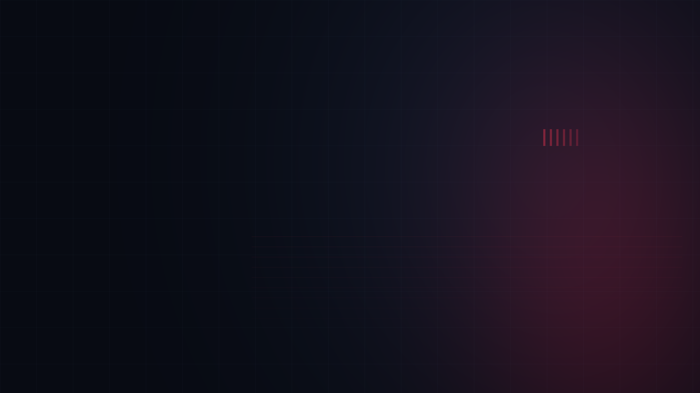

# WORKSTATION ULTIMATE — NOCTURNE

> Windows 11 desktop customization: **GlazeWM + Zebar + Rainmeter**, a compact dark Red Team dock and interactive desktop widgets.



## What you get

- **GlazeWM** tiling window manager and nine organized workspaces (with optional `-ApplyGlazeWM`).
- **Zebar** custom Catppuccin-style top bar with workspaces, network, CPU, RAM, battery and weather.
- **Rainmeter** compact dock + expandable **Operations**, **Control Center** (live calendar and system volume), and **Launcher** (app and native Windows shortcuts).
- Optional original **red/navy wallpaper**. Its artwork is freely included with the repository; no third-party wallpapers are redistributed.
- Installer, health check, backups and restore. No WSL, Docker or SSH configuration is changed.

## RC1 hotfix (2026-11-15)

Fixed Rainmeter CLI invocation in `install.ps1`: bangs and their parameters are now passed as separate arguments. The previous archive could cause an erroneous `C:\Program Files\Rainmeter\DeactivateConfig\...\Rainmeter.ini` permissions warning. If you used that installer, close Rainmeter from its tray icon, use this corrected package and restart normally. **Do not change permissions of Program Files or run Rainmeter elevated.**

## Install in a few clicks (Windows 11)

1. **Install prerequisites**: [GlazeWM](https://github.com/glzr-io/glazewm) (select **Zebar** in its installer), [Rainmeter](https://www.rainmeter.net/) and [Windows Terminal](https://github.com/microsoft/terminal). Or use the optional `-InstallApps` flag below, which also requests the Zebar package.
2. Click **Code → Download ZIP** on this repository, unzip it, open the `WORKSTATION-NOCTURNE` folder, then open **PowerShell** in that folder.
3. Run:

   ```powershell
   .\install.ps1 -SetWallpaper
   ```

   If your machine has no dependencies, run `winget install --id glzr-io.glazewm -e` and `winget install --id glzr-io.zebar -e` and `winget install --id Rainmeter.Rainmeter -e`, then launch their applications. Optional `-InstallApps` automates package installation requests, but Zebar's installer checkbox may require interaction.
4. In **Zebar**, choose pack **WORKSTATION-BAR** with widget `with-glazewm` and reload configs. Launch GlazeWM. Run Rainmeter or open **Manage → WORKSTATION → Dock → Dock.ini → Load**.
5. Click the left dock buttons. The first shows **Operations**, the second opens **Launcher**, and **CC** shows the **Control Center**.

**Existing GlazeWM users:** The installer does **not overwrite your GlazeWM configuration by default**, so your hotkeys/workspaces remain intact. To use this repository's nine-workspace template on a new machine, explicitly run:

```powershell
.\install.ps1 -ApplyGlazeWM -SetWallpaper
```

The installer backs up replaced files first. The optional `-ApplyGlazeWM` flag **replaces existing GlazeWM hotkeys**: review the YAML before applying it. It can be used for a new machine, but avoid it on your daily workstation unless intended.

### If PowerShell blocks local scripts

Inspect `install.ps1` first. Windows may mark files downloaded from the internet; after reviewing, use `Unblock-File .\install.ps1` or your permitted execution policy. **Do not disable security protections system-wide.**

## Update your personal setup before publishing

If this is your own WORKSTATION and you have already hand-tuned Rainmeter/Zebar, run:

```powershell
.\export-current.ps1
```

This copies your current working **Zebar and Rainmeter** files into `theme/`, except the Dock: the bundled Dock intentionally adds the new Launcher action. To export your old Dock instead, opt in with `-IncludeDock` and review its app button mapping. To include your exact keyboard shortcuts as well, use `-IncludeGlazeWM`, inspect the exported YAML for private paths, and only then commit. The package's included GlazeWM template is from an earlier tested configuration and may not include all your latest hotkeys until exported.

Review before publishing:

```powershell
git diff --check
git status -sb
git diff --stat
```

## Recovery

Every install creates a backup under `%USERPROFILE%\.config\workstation\backups\nocturne-TIMESTAMP` with a manifest. Restore the most recent install with:

```powershell
.\restore.ps1
```

The restore script asks you to type `RESTORE`. It reverses only installed files. It does not automatically revert the Windows wallpaper; see `previous-wallpaper-path.txt` in the backup directory if you changed it.

## Verify

```powershell
.\check.ps1
```

## Optional development tools

The interface is deliberately separate from development and security tooling. To install a curated baseline when desired:

```powershell
.\tools\install-tools.ps1 -Dev
```

This is optional, may prompt for installation, and does not install Kali/Parrot or pentesting packages. WSL and Docker remain personal choices.

## Important limitations

- Native Windows notification history and quick settings use **Windows-native panels**, not a copied notification database. Native panel shortcuts are launched via a small PowerShell helper and must be validated on each machine.
- Launcher is a **shortcut dashboard**, not yet a custom full-text search engine. The search button opens Windows Search.
- GlazeWM/Zebar versions and user settings may differ; the installer cannot guarantee identical behavior on all displays, DPI settings or Windows builds.
- Background skins are not a replacement for Windows's taskbar or security UI. The taskbar may be auto-hidden using Windows settings.
- This repository does not include licensed third-party wallpapers or private credentials.

## Architecture

```text
Windows 11
  ├── GlazeWM                   window layout / keyboard shortcuts
  ├── Zebar WORKSTATION-BAR      top metrics / workspaces
  └── Rainmeter WORKSTATION
        ├── Dock                icon navigation
        ├── Operations          real CPU/RAM/network/disk
        ├── ControlCenter       calendar, master volume, settings
        └── Launcher            application and native Windows shortcuts
```

## Credits and licenses

This repository bundles custom configuration files and a procedurally created wallpaper. [GlazeWM](https://github.com/glzr-io/glazewm), [Zebar](https://github.com/glzr-io/zebar), and [Rainmeter](https://www.rainmeter.net/) are separate third-party projects, with their own licenses and distribution terms. Not affiliated with them.

The supplied configuration/scripts are made available under the [MIT License](LICENSE). The upstream dependencies retain their own licenses. Feel free to fork and adapt, and report problems through GitHub Issues.

## DESKTOP DOCK / RED TEAM V1.1

The left Rainmeter dock uses **On desktop** (`DefaultAlwaysOnTop=-2`) and
GlazeWM reserves a **60px left rail**. This keeps the dock accessible beside
tiled windows without covering application content. The panels (Operations,
Control Center and Launcher) intentionally open above applications temporarily.

For an existing installation, run `repair-desktop.ps1` from PowerShell
within this repository, or use the `NOCTURNE_DESKTOP_FIX.zip` distribution. This backs up
live and repository files before making changes. The optional `-Publish` flag
commits only the Nocturne files changed by this repair to your GitHub remote.
The included wallpaper is an original Red Team image. When cloning, use
`install.ps1 -ApplyGlazeWM -SetWallpaper` only if you agree to replacing your
existing GlazeWM keybindings (the installer creates a backup).
## NOCTURNE Interactive UI V2

Install/update from the separate NOCTURNE_INTERACTIVE_V2.zip package by
running `upgrade.ps1` inside the extracted folder. This preserves GlazeWM,
Zebar, wallpaper, WSL and Docker. It backs up old Rainmeter files first.

Dock (desktop layer, reserved 60px): Home, Launcher, Activity, Operations,
Control Center, Terminal, Explorer, Settings and Task Manager. Only one
expandable Rainmeter module opens at a time; popups intentionally overlay
app windows briefly. Home has real CPU/RAM metrics, calendar and global
media key buttons. Activity offers master volume and links to the actual
Windows Notification Center (Win+N) and Quick Settings (Win+A). It does not
claim to read private Windows notifications or toggle Wi-Fi directly.

Rollback: run `restore.ps1 -BackupPath <backup-directory>` from the
upgrade package. Reopen Rainmeter if needed. No automatic git push occurs.

## NOCTURNE COMMAND DECK V3

Barra Zebar de 48px con ventanas reales de GlazeWM, indicadores de sistema,
media controls, dock lateral de 60px, Home, Activity y Launcher con datos
reales de Windows. Instala las dependencias, despues ejecuta:
`./WORKSTATION-NOCTURNE/install-v3.ps1`. Documentacion:
`WORKSTATION-NOCTURNE/README-V3.md`. Backups y restauracion incluidos.
## WORKSTATION NOCTURNE V3.1

Command Deck V3 with the working Red Team top bar,
interactive Rainmeter panels and real system metrics.

Read [V3.1 documentation](README-V3.1.md) before installing
or upgrading an existing workstation.